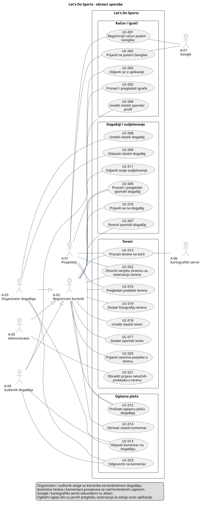

# 3. Obrasci uporabe

Obrasci opisuju dogovoreno ponašanje aplikacije Let's Do Sports prema [opsegu projekta](1-Projekt.md), [analizi zahtjeva](2-Analiza-zahtjeva.md) i [API ugovoru](meeting-notes/api-endpoints.md). Dokument obuhvaća i planirane funkcionalnosti; nije potvrda da su svi tokovi implementirani ili ispitani.

**Pretpostavke koje je potrebno usuglasiti unutar tima:**

- Za događaje se preuzima ponašanje postojećeg koda: obavezan naziv i postojeći teren, minimalna dob od barem 13 godina, opcionalna gornja dob i minimalna razina iskustva te ograničenja radnji prema statusu događaja. Izvori su CreateEventRequest, UpdateEventRequest i EventService u [modulu događaja](../backend/LetsDoSports/src/main/java/hr/fer/letsdosports/event/) te EventMemberService u [modulu sudjelovanja](../backend/LetsDoSports/src/main/java/hr/fer/letsdosports/eventmember/). Područje proizlazi iz odabranog terena; time se za ove obrasce precizira opis „teren ili mjesto” iz analize zahtjeva.
- Donja dobna granica od 13 godina odnosi se na uvjet događaja; ovime se ne uvodi novo pravilo dobi za registraciju.
- Javno čitanje oglasne ploče, očuvanje odgovora uz oznaku obrisanog izvornog komentara te zabrana brisanja terena povezanog s događajima. Ograničenje brisanja povezanog terena postoji i u [shemi baze](../db/migrations/V2__events_schema.sql).

## 3.1 Dijagram obrazaca uporabe

**Slika 3.1. Dijagram obrazaca uporabe sustava Let's Do Sports**

**PlantUML izvor:** [3-1-lets-do-sports-UC.puml](./puml/3-1-lets-do-sports-UC.puml)

Akteri A-01 - A-07 preuzeti su iz [analize zahtjeva](2-Analiza-zahtjeva.md#23-dionici-i-akteri). Organizator i sudionik specijalizacije su registriranog korisnika u odnosu na pojedini događaj. Autorstvo terena ili komentara provjerava se nad konkretnim sadržajem i ne uvodi zasebnu vrstu računa. Registrirani korisnik i administrator imaju pristup javnim pregledima; zajedničke veze prema tim pregledima prikazane su i preko nasljeđivanja aktera.

Google sudjeluje u registraciji i prijavi, a kartografski servis u pregledu karte. Vanjska stranica za rezervaciju samo je odredište poveznice, bez razmjene podataka o rezervacijama s aplikacijom. Studentski tim i nastavnici dionici su projekta, a ne akteri ovog dijagrama. Prijava je preduvjet zaštićenih radnji, pa nije ponavljana odnosom `<<include>>`.

### 3.1.1 Uključivanje i proširenje

Veze slijede skriptu *Modeliranje programske potpore UML dijagramima*, poglavlje 3, odjeljke 3.1.2.2 i 3.1.2.3 (primjeri na tiskanim stranicama 49–52). Oznaka `<<include>>` znači obavezno uključeno ponašanje, a strelica vodi od glavnog prema uključenom UC-u. Oznaka `<<extend>>` znači opcionalno ponašanje, a strelica vodi od proširenja prema osnovnom UC-u. Te veze ne određuju redoslijed svih radnji u aplikaciji.

**Obavezno uključivanje:**

| Veza | Obrazloženje |
| :--- | :--- |
| UC-023 `<<include>>` UC-013 | Odgovor se objavljuje istim postupkom kao komentar: unos teksta, provjera prava i nepraznog sadržaja, spremanje i prikaz. UC-023 dodatno određuje i provjerava izvorni komentar. Nastaje jedan odgovor povezan s izvornikom. |
| UC-021 `<<include>>` UC-016 | Administrator pri obradi prijave pregledava podatke prijavljenog terena prije odluke o ispravku, uklanjanju ili odbijanju prijave. Pregled je obavezan i kada se prijava odbije. |

**Opcionalna proširenja:** uvjet je korisnikov odabir radnje na navedenoj točki proširenja. Za zaštićenu radnju vrijede prijava, uloga i ostali preduvjeti njezine specifikacije; status, unos i ovlasti provjeravaju se pri izvršavanju.

| Osnovni UC i točka proširenja | Proširujući UC → osnovni UC (`<<extend>>`) | Odabir koji pokreće proširenje |
| :--- | :--- | :--- |
| UC-006, prikazani detalji događaja (korak 4) | UC-008 → UC-006 | Organizator odabire uređivanje svojeg događaja. |
| UC-006, prikazani detalji događaja (korak 4) | UC-009 → UC-006 | Organizator odabire otkazivanje svojeg događaja. |
| UC-006, prikazani detalji događaja (korak 4) | UC-010 → UC-006 | Registrirani korisnik odabire prijavu na događaj. |
| UC-006, prikazani detalji događaja (korak 4) | UC-011 → UC-006 | Sudionik koji nije organizator odabire odjavu sudjelovanja. |
| UC-012, prikazana oglasna ploča (korak 2) | UC-013 → UC-012 | Organizator ili sudionik odabire objavu novog komentara. |
| UC-012, prikazana oglasna ploča (korak 2) | UC-014 → UC-012 | Autor odabire brisanje svojeg komentara ili odgovora. |
| UC-012, prikazana oglasna ploča (korak 2) | UC-023 → UC-012 | Organizator ili sudionik odabire „Reply” uz postojeći komentar. |
| UC-015, prikazana karta s oznakama (korak 2) | UC-016 → UC-015 | Akter odabire oznaku terena radi pregleda njegovih podataka. |
| UC-016, prikazani podaci terena (korak 2) | UC-018 → UC-016 | Autor odabire uređivanje svojeg terena. |
| UC-016, prikazani podaci terena (korak 2) | UC-019 → UC-016 | Registrirani korisnik odabire dodavanje fotografije. |
| UC-016, prikazani podaci terena (korak 2) | UC-020 → UC-016 | Registrirani korisnik odabire prijavu netočnih podataka. |
| UC-016, prikazani podaci terena (korak 2) | UC-022 → UC-016 | Akter odabire postojeću vanjsku poveznicu za rezervaciju. |

Osnovni pregled može završiti bez ijednog proširenja: korisnik može samo pročitati događaj, komentare ili podatke terena. Prijava na događaj ne uključuje odjavu, a stvaranje događaja ne uključuje UC-010: organizator se dodaje automatski. Početna fotografija u UC-017 ostaje dio stvaranja terena; UC-019 odnosi se na dodavanje fotografije već postojećem terenu. Nisu dodani novi UC-ovi ni promijenjene ovlasti aktera.

## 3.2 Specifikacije obrazaca uporabe

Kod svake zaštićene radnje sustav na poslužitelju provjerava prijavu i ovlasti nad konkretnim zapisom (NF-01, NF-02). Ako prijava nedostaje ili istekne, radnja se odbija do ponovne prijave. Ako akter nema ovlast, promjena se odbija bez izmjene podataka. Nepostojeći zapis prijavljuje se razumljivom porukom.

Pri neuspješnoj pohrani sustav ne prikazuje potvrdu uspjeha; povezane promjene pojedine operacije moraju se spremiti zajedno ili ostati neprovedene. Uspješno spremljeni podaci i fotografije ostaju dostupni nakon ponovnog pokretanja (NF-03). Sučelje i poruke trebaju biti čitljivi na računalu i mobitelu (NF-04, NF-05). U tablicama se dodatno navode alternative važne za konkretni cilj.

### UC-001: Registrirati račun putem Googlea

| Element specifikacije | Opis |
| :--- | :--- |
| **Primarni akter** | A-01 Posjetitelj; sekundarni akter: A-07 Google. |
| **Povezani zahtjevi** | F-001, F-004. |
| **Preduvjeti** | Posjetitelj nema lokalni račun povezan s odabranim Google identitetom. |
| **Glavni uspješni tok** | 1. Posjetitelj odabire registraciju putem Googlea. 2. Google provodi autentifikaciju, a aplikacija provjerava vraćeni identitet. 3. Aplikacija prikazuje početni obrazac profila. Posjetitelj unosi ime, jedinstveni username, spol, datum rođenja, grad i barem jedan sport s razinom iskustva. 4. Posjetitelj šalje obrazac; aplikacija provjerava unos i zajedno sprema lokalni račun, sportove i vezu s Google identitetom. 5. Aplikacija potvrđuje registraciju i omogućuje radnje prijavljenog korisnika. |
| **Alternativni tokovi / Iznimke** | **2a - Prekinuta ili nevaljana prijava:** Račun ne nastaje i zaštićene radnje nisu dostupne; posjetitelj može ponovno pokrenuti registraciju. **2b - Postojeći Google identitet:** Aplikacija prepoznaje postojeći račun i nastavlja prijavom iz UC-002, bez dupliciranja računa. **3a - Odustajanje:** Zatvaranje početnog obrasca ne stvara lokalni račun niti omogućuje radnje registriranog korisnika. **4a - Nevaljan profil ili zauzet username:** Aplikacija objašnjava pogrešku; ništa se ne sprema, a posjetitelj ispravlja unos i ponavlja korak 4. |
| **Posljedice (ishod)** | Postoji potpun lokalni račun povezan s jednim Google računom. Fotografija je opcionalna i može se postaviti kroz UC-004. Aplikacija ne prikuplja korisnikovu Google lozinku. |

### UC-002: Prijaviti se putem Googlea

| Element specifikacije | Opis |
| :--- | :--- |
| **Primarni akter** | A-01 Posjetitelj s postojećim računom; sekundarni akter: A-07 Google. |
| **Povezani zahtjevi** | F-002. |
| **Preduvjeti** | Postoji lokalni račun povezan s odabranim Google identitetom. |
| **Glavni uspješni tok** | 1. Posjetitelj pokreće prijavu i odabire Google račun. 2. Google provodi autentifikaciju, a aplikacija provjerava rezultat. 3. Aplikacija prepoznaje lokalni račun prema Googleovu identifikatoru sub i omogućuje prijavljeni pristup. |
| **Alternativni tokovi / Iznimke** | **2a - Odustajanje ili neuspjeh:** Korisnik ostaje neprijavljen i dobiva razumljivu poruku. **3a - Google identitet nema lokalni račun:** Nastavlja se početnom registracijom iz UC-001. Drugi Google račun ne spaja se s postojećim prema e-pošti. |
| **Posljedice (ishod)** | Korisnik ima pristup svojem postojećem računu. Ne stvara se novi račun pri svakoj prijavi; povezivanje ili promjena Google računa nisu podržani. |

### UC-003: Odjaviti se iz aplikacije

| Element specifikacije | Opis |
| :--- | :--- |
| **Primarni akter** | A-02 Registrirani korisnik. |
| **Povezani zahtjevi** | F-003. |
| **Preduvjeti** | Korisnik je prijavljen u aplikaciju. |
| **Glavni uspješni tok** | 1. Korisnik odabire odjavu. 2. Aplikacija završava prijavljeni pristup i prikazuje javni prikaz. |
| **Alternativni tokovi / Iznimke** | **2a - Odjava nije potvrđena:** Aplikacija prijavljuje problem i omogućuje ponovni pokušaj; ne prikazuje lažnu potvrdu odjave. |
| **Posljedice (ishod)** | Zaštićene radnje zahtijevaju novu prijavu. Odjava iz aplikacije ne znači odjavu iz Google računa. |

### UC-004: Urediti vlastiti sportski profil

| Element specifikacije | Opis |
| :--- | :--- |
| **Primarni akter** | A-02 Registrirani korisnik. |
| **Povezani zahtjevi** | F-004. |
| **Preduvjeti** | Korisnik je prijavljen i ima lokalni račun. Početno popunjavanje profila dio je UC-001. |
| **Glavni uspješni tok** | 1. Korisnik otvara vlastiti profil; aplikacija prikazuje postojeće podatke. 2. Korisnik mijenja željene podatke: ime, username, spol, datum rođenja, grad ili sportove s iskustvom. 3. Korisnik sprema promjene; aplikacija provjerava cjelovitost profila i jedinstvenost usernamea te sprema izmijenjene podatke. 4. Po želji korisnik postavlja ili zamjenjuje profilnu fotografiju; aplikacija sprema fotografiju i prikazuje ažurirani profil. |
| **Alternativni tokovi / Iznimke** | **3a - Nepotpun ili nevaljan unos:** Prazno obavezno polje, budući datum rođenja, nepostojeći odabir ili izostanak svih sportova odbijaju se; korisnik ispravlja unos i ponavlja korak 3. **3b - Username je zauzet:** Promjena se odbija i korisnik bira drugi username. **4a - Fotografija se ne može spremiti:** Aplikacija objašnjava problem; prethodno uspješno spremljeni podaci profila ostaju dostupni. |
| **Posljedice (ishod)** | Vlastiti profil ažuriran je uz očuvanje svih obaveznih podataka i barem jednog sporta s iskustvom. Izostavljeni podaci pri djelomičnoj izmjeni ostaju nepromijenjeni; dob se računa iz datuma rođenja. |

### UC-005: Pronaći i pregledati igrače

| Element specifikacije | Opis |
| :--- | :--- |
| **Primarni akter** | A-02 Registrirani korisnik. |
| **Povezani zahtjevi** | F-005. |
| **Preduvjeti** | Korisnik je prijavljen. |
| **Glavni uspješni tok** | 1. Korisnik otvara pregled igrača. 2. Po želji odabire sport, grad, dobni raspon i točnu razinu iskustva za odabrani sport. 3. Aplikacija prikazuje igrače koji zadovoljavaju sve odabrane kriterije; izostavljeni filtri ne ograničavaju rezultate. 4. Korisnik odabire igrača i pregledava njegov profil. |
| **Alternativni tokovi / Iznimke** | **2a - Iskustvo bez sporta:** Aplikacija odbija takvu kombinaciju i traži odabir sporta ili uklanjanje filtra iskustva. **3a - Nema rezultata:** Aplikacija prikazuje poruku; korisnik može promijeniti filtre. |
| **Posljedice (ishod)** | Popis i pojedinačni profil prikazuju ID, username, ime, opcionalnu fotografiju, dob, grad te sportove s iskustvom. Ne prikazuju datum rođenja, spol, e-poštu, OAuth podatke ni aplikacijsku ulogu. |

### UC-006: Pronaći i pregledati sportski događaj

| Element specifikacije | Opis |
| :--- | :--- |
| **Primarni akter** | A-01 Posjetitelj ili A-02 Registrirani korisnik. |
| **Povezani zahtjevi** | F-006; prikaz oglednih oglasa: F-023. |
| **Preduvjeti** | Prijava nije potrebna. |
| **Glavni uspješni tok** | 1. Akter otvara pregled događaja. 2. Po želji filtrira događaje prema sportu, području, terminu ili statusu. 3. Aplikacija prikazuje odgovarajuće događaje. 4. Akter otvara detalje; aplikacija prikazuje naziv, sport, organizatora, teren i područje, termin, opis, status, broj sudionika, kapacitet te zadane dobne uvjete i minimalno iskustvo. |
| **Alternativni tokovi / Iznimke** | **3a - Nema rezultata:** Aplikacija prikazuje poruku i omogućuje promjenu filtara. **4a - Otkazan ili popunjen događaj:** Detalji ostaju dostupni uz vidljivu oznaku statusa; nova prijava nije moguća. |
| **Posljedice (ishod)** | Akter ima pregled podataka i uvjeta događaja, bez promjene sudjelovanja. U javnom sučelju na predviđenim mjestima prikazuju se označeni ogledni oglasi. |

### UC-007: Stvoriti sportski događaj

| Element specifikacije | Opis |
| :--- | :--- |
| **Primarni akter** | A-02 Registrirani korisnik. |
| **Povezani zahtjevi** | F-007. |
| **Preduvjeti** | Korisnik je prijavljen; postoji teren koji podržava odabrani sport. |
| **Glavni uspješni tok** | 1. Korisnik otvara obrazac za novi događaj. 2. Unosi naziv do 40 znakova, odabire sport i postojeći teren, termin koji nije u prošlosti, maksimalan broj sudionika i minimalnu dob od barem 13 godina. Po želji dodaje opis, očekivano trajanje, maksimalnu dob i minimalno iskustvo. 3. Korisnik šalje obrazac; aplikacija provjerava unos, sportove terena i zadane uvjete. 4. Aplikacija zajedno sprema događaj i organizatora kao prvog sudionika te prikazuje detalje događaja. |
| **Alternativni tokovi / Iznimke** | **3a - Nevaljan unos:** Nedostaju obavezni podaci, kapacitet je manji od jedan, termin je u prošlosti, trajanje nije pozitivno ili je maksimalna dob manja od minimalne. Aplikacija odbija unos i traži ispravak. **3b - Neodgovarajući teren ili odabir:** Teren ne podržava odabrani sport ili odabrani podatak ne postoji; korisnik mijenja odabir i ponavlja korak 3. |
| **Posljedice (ishod)** | Događaj je dostupan u javnom pregledu. Autor postaje organizator i prvi sudionik te ulazi u maksimalan broj sudionika. |

### UC-008: Urediti vlastiti događaj

| Element specifikacije | Opis |
| :--- | :--- |
| **Primarni akter** | A-03 Organizator događaja. |
| **Povezani zahtjevi** | F-008. |
| **Preduvjeti** | Organizator je prijavljen; događaj postoji i nije otkazan ni završen. |
| **Glavni uspješni tok** | 1. Organizator otvara uređivanje svojeg događaja. 2. Mijenja naziv, opis, sport, teren, termin, trajanje, kapacitet ili dobne uvjete i minimalno iskustvo. 3. Aplikacija provjerava ovlasti, status i valjanost novih podataka prema pravilima iz UC-007 te broj sudionika. 4. Aplikacija sprema promjene i prikazuje ažurirane detalje. |
| **Alternativni tokovi / Iznimke** | **3a - Premalen kapacitet:** Novi maksimum manji je od trenutačnog broja sudionika; promjena se odbija i organizator ispravlja unos. **3b - Nevaljan unos:** Promjene ne zadovoljavaju pravila podataka događaja; ništa se ne sprema. **3c - Promijenjen status:** Ako je događaj u međuvremenu otkazan ili završen, uređivanje se odbija. |
| **Posljedice (ishod)** | Događaj ima ažurirane podatke; broj sudionika ne prelazi kapacitet. Prema postojećem kodu uređivanje je dopušteno i dok događaj traje, uz navedene provjere. |

### UC-009: Otkazati vlastiti događaj

| Element specifikacije | Opis |
| :--- | :--- |
| **Primarni akter** | A-03 Organizator događaja. |
| **Povezani zahtjevi** | F-009. |
| **Preduvjeti** | Organizator je prijavljen; događaj postoji i nije otkazan ni završen. |
| **Glavni uspješni tok** | 1. Organizator odabire otkazivanje svojeg događaja. 2. Aplikacija provjerava ovlasti i status te označava događaj otkazanim. 3. Aplikacija prikazuje vidljivu oznaku otkazivanja i onemogućuje nove prijave. |
| **Alternativni tokovi / Iznimke** | **2a - Već otkazan ili završen događaj:** Aplikacija odbija radnju i objašnjava trenutačni status. |
| **Posljedice (ishod)** | Događaj ostaje dohvatljiv s oznakom otkazivanja. Otkazivanje ne briše zapis ni popis sudionika i ne šalje obavijesti. |

### UC-010: Prijaviti se na događaj

| Element specifikacije | Opis |
| :--- | :--- |
| **Primarni akter** | A-02 Registrirani korisnik. |
| **Povezani zahtjevi** | F-010. |
| **Preduvjeti** | Korisnik je prijavljen i odabrao je postojeći događaj. |
| **Glavni uspješni tok** | 1. Korisnik u detaljima događaja odabire prijavu. 2. Aplikacija provjerava da korisnik još nije sudionik, da je događaj otvoren i ima slobodno mjesto te da korisnik zadovoljava dobne uvjete i zadano minimalno iskustvo za sport događaja. 3. Aplikacija dodaje korisnika među sudionike i prikazuje ažurirani broj sudionika, bez odobrenja organizatora. |
| **Alternativni tokovi / Iznimke** | **2a - Postojeća prijava:** Ponovna prijava odbija se bez dupliciranja sudjelovanja. **2b - Popunjen, otkazan, započet ili završen događaj:** Prijava se odbija uz objašnjenje statusa. **2c - Nezadovoljeni uvjeti:** Dob je izvan zadanog raspona ili iskustvo za sport nedostaje odnosno niže je od minimalnog; prijava se odbija uz objašnjenje. **3a - Istodobna prijava za zadnje mjesto:** Mjesto dobiva samo jedan korisnik; drugi dobiva poruku da je događaj popunjen. |
| **Posljedice (ishod)** | Korisnik postaje A-04 Sudionik događaja. Kapacitet, uključujući organizatora, nije prekoračen ni pri istodobnim pokušajima. |

### UC-011: Odjaviti svoje sudjelovanje

| Element specifikacije | Opis |
| :--- | :--- |
| **Primarni akter** | A-04 Sudionik događaja koji nije organizator. |
| **Povezani zahtjevi** | F-011. |
| **Preduvjeti** | Sudionik je prijavljen u aplikaciju i sudjeluje u događaju. |
| **Glavni uspješni tok** | 1. Sudionik otvara događaj, primjerice iz pregleda vlastitih događaja, i odabire odjavu sudjelovanja. 2. Aplikacija provjerava članstvo i da je događaj otvoren ili popunjen te uklanja njegovo sudjelovanje. 3. Aplikacija prikazuje novi broj sudionika. |
| **Alternativni tokovi / Iznimke** | **2a - Organizator pokušava odjavu:** Aplikacija odbija odjavu i upućuje na otkazivanje događaja iz UC-009. **2b - Događaj je započeo, završio ili je otkazan:** Odjava se odbija uz objašnjenje. **2c - Korisnik više nije sudionik:** Odjava se odbija bez promjene tuđeg sudjelovanja. |
| **Posljedice (ishod)** | Korisnik više nije sudionik, oslobađa se mjesto i prestaje pravo objave na ploči po osnovi sudjelovanja. |

### UC-012: Pročitati oglasnu ploču događaja

| Element specifikacije | Opis |
| :--- | :--- |
| **Primarni akter** | A-01 Posjetitelj ili A-02 Registrirani korisnik. |
| **Povezani zahtjevi** | F-012, F-024. |
| **Preduvjeti** | Događaj postoji; prijava i sudjelovanje nisu potrebni za čitanje. |
| **Glavni uspješni tok** | 1. Akter otvara oglasnu ploču događaja. 2. Aplikacija prikazuje komentare i odgovore u jedinstvenom kronološkom popisu, s autorom i vremenom objave te oznakom izvornog komentara uz odgovor. 3. Akter osvježava ili ponovno otvara stranicu kako bi vidio nove komentare. |
| **Alternativni tokovi / Iznimke** | **2a - Nema komentara:** Prikazuje se poruka da je ploča prazna. **2b - Izvorni komentar je obrisan:** Odgovori ostaju vidljivi uz neutralnu oznaku obrisanog izvornika, bez njegova teksta. **3a - Dohvat nije uspio:** Aplikacija prikazuje pogrešku i omogućuje ponovni pokušaj. |
| **Posljedice (ishod)** | Akter čita dogovor bez promjene podataka. Nove poruke ne pristižu u stvarnom vremenu i ne šalju se obavijesti. |

### UC-013: Objaviti komentar na događaju

| Element specifikacije | Opis |
| :--- | :--- |
| **Primarni akter** | A-03 Organizator ili A-04 Sudionik događaja. |
| **Povezani zahtjevi** | F-013. |
| **Preduvjeti** | Akter je prijavljen; događaj postoji i akter je njegov organizator ili trenutačni sudionik. |
| **Glavni uspješni tok** | 1. Akter na ploči upisuje tekst komentara. 2. Akter odabire objavu; aplikacija provjerava pravo objave i neprazan tekst. 3. Aplikacija sprema komentar, postavlja autora i vrijeme te ga prikazuje na ploči. |
| **Alternativni tokovi / Iznimke** | **2a - Prazan komentar:** Objava se odbija; akter dopunjava tekst i ponavlja korak 2. **2b - Prestalo sudjelovanje:** Ako akter više nije sudionik ni organizator, objava se odbija bez spremanja. |
| **Posljedice (ishod)** | Komentar je pohranjen uz događaj; ostali ga vide pri sljedećem otvaranju ili osvježavanju ploče. |

### UC-014: Obrisati vlastiti komentar

| Element specifikacije | Opis |
| :--- | :--- |
| **Primarni akter** | A-02 Registrirani korisnik, autor komentara ili odgovora. |
| **Povezani zahtjevi** | F-014, F-024. |
| **Preduvjeti** | Korisnik je prijavljen i njegov komentar postoji. Za brisanje vlastitog komentara nije potrebno trenutačno sudjelovanje u događaju. |
| **Glavni uspješni tok** | 1. Autor uz vlastiti komentar odabire brisanje. 2. Aplikacija provjerava autorstvo i briše sadržaj komentara. 3. Aplikacija osvježava prikaz ploče. |
| **Alternativni tokovi / Iznimke** | **2a - Tuđi komentar:** Brisanje se odbija bez promjene podataka. **3a - Postoje odgovori:** Odgovori se ne brišu; zadržavaju vezu s izvornikom uz neutralnu oznaku da je obrisan. Njegov izvorni tekst više se ne prikazuje. |
| **Posljedice (ishod)** | Sadržaj obrisanog komentara više nije vidljiv ni nakon osvježavanja, a postojeći odgovori ostaju čitljivi. |

### UC-015: Pronaći terene na karti

| Element specifikacije | Opis |
| :--- | :--- |
| **Primarni akter** | A-01 Posjetitelj ili A-02 Registrirani korisnik; sekundarni akter: A-06 Kartografski servis. |
| **Povezani zahtjevi** | F-015; prikaz oglednih oglasa: F-023. |
| **Preduvjeti** | Prijava nije potrebna. |
| **Glavni uspješni tok** | 1. Akter otvara kartu terena. 2. Aplikacija prikazuje kartu s podacima OpenStreetMapa, oznaku izvora podataka i oznake terena na spremljenim koordinatama. 3. Po želji akter odabire oznaku i otvara podatke terena kroz proširenje UC-016; pregled karte može završiti bez tog odabira. |
| **Alternativni tokovi / Iznimke** | **2a - Nema terena:** Karta nema oznake i aplikacija prikazuje poruku. **2b - Karta nije dostupna:** Aplikacija objašnjava da se karta ne može učitati i omogućuje ponovni pokušaj; ne prikazuje netočne lokacije. |
| **Posljedice (ishod)** | Akter pronalazi teren i može pregledati njegove podatke. U sučelju se na predviđenim mjestima prikazuju označeni ogledni oglasi, bez povezivanja s oglasnom mrežom. |

### UC-016: Pregledati podatke terena

| Element specifikacije | Opis |
| :--- | :--- |
| **Primarni akter** | A-01 Posjetitelj ili A-02 Registrirani korisnik. |
| **Povezani zahtjevi** | F-016. |
| **Preduvjeti** | Teren postoji; prijava nije potrebna. |
| **Glavni uspješni tok** | 1. Akter otvara odabrani teren. 2. Aplikacija prikazuje naziv, lokaciju, grad, sportove, fotografije, opis, podatak o naplati i mogućnosti rezervacije. 3. Ako postoji vanjska poveznica za rezervaciju, akter je može slijediti kroz UC-022. |
| **Alternativni tokovi / Iznimke** | **3a - Poveznica nije unesena:** Ne prikazuje se aktivna poveznica, čak ni ako teren podržava rezervacije. |
| **Posljedice (ishod)** | Akter je upoznat s podacima terena; aplikacija ne prikazuje vlastitu evidenciju slobodnih termina. |

### UC-017: Dodati sportski teren

| Element specifikacije | Opis |
| :--- | :--- |
| **Primarni akter** | A-02 Registrirani korisnik. |
| **Povezani zahtjevi** | F-017. |
| **Preduvjeti** | Korisnik je prijavljen. |
| **Glavni uspješni tok** | 1. Korisnik otvara obrazac za dodavanje terena. 2. Unosi naziv, lokaciju na karti, grad, sportove, početnu fotografiju, opis te podatke o naplati i mogućnosti rezervacije. Po želji unosi adresu i dostupnu vanjsku poveznicu za rezervaciju. 3. Korisnik šalje obrazac; aplikacija provjerava podatke i početnu fotografiju. 4. Aplikacija sprema teren, sportove i fotografiju, bilježi autora te prikazuje novi teren. |
| **Alternativni tokovi / Iznimke** | **3a - Nedostaju obavezni podaci:** Bez naziva, valjane lokacije, grada, barem jednog sporta ili početne fotografije teren se ne sprema; korisnik ispravlja unos. **3b - Poveznica bez mogućnosti rezervacije:** Aplikacija odbija nedosljedan unos i traži ispravak. **4a - Fotografija se ne može spremiti:** Dodavanje se ne smatra uspješnim i teren bez obavezne početne fotografije ne postaje dostupan kao uspješno dodan unos. |
| **Posljedice (ishod)** | Teren je dostupan u javnom pregledu i na karti; korisnik je njegov autor. |

### UC-018: Urediti vlastiti teren

| Element specifikacije | Opis |
| :--- | :--- |
| **Primarni akter** | A-02 Registrirani korisnik, autor terena. |
| **Povezani zahtjevi** | F-018. |
| **Preduvjeti** | Korisnik je prijavljen i autor je postojećeg terena. Administratorski ispravci opisani su u UC-021. |
| **Glavni uspješni tok** | 1. Autor otvara uređivanje svojeg terena. 2. Mijenja podatke terena i šalje izmjene. 3. Aplikacija provjerava autorstvo i valjanost podataka, uključujući sportove, lokaciju i dosljednost rezervacijske poveznice. 4. Aplikacija sprema promjene i prikazuje ažurirane podatke. |
| **Alternativni tokovi / Iznimke** | **3a - Nevaljan unos:** Aplikacija odbija promjene i traži ispravak; prethodni podaci ostaju nepromijenjeni. **3b - Tuđi teren:** Obični korisnik ne može spremiti promjene tuđeg terena. |
| **Posljedice (ishod)** | Izmjene su vidljive nakon ponovnog otvaranja terena. Nove fotografije dodaju se kroz UC-019. |

### UC-019: Dodati fotografiju terena

| Element specifikacije | Opis |
| :--- | :--- |
| **Primarni akter** | A-02 Registrirani korisnik. |
| **Povezani zahtjevi** | F-019. |
| **Preduvjeti** | Korisnik je prijavljen; teren postoji. Korisnik ne mora biti autor terena. |
| **Glavni uspješni tok** | 1. Korisnik na terenu odabire dodavanje fotografije i datoteku. 2. Aplikacija provjerava datoteku i sprema fotografiju povezanu s terenom. 3. Aplikacija prikazuje dodanu fotografiju. |
| **Alternativni tokovi / Iznimke** | **2a - Datoteka nije prihvatljiva ili pohrana nije uspjela:** Aplikacija odbija dodavanje i prikazuje razlog; postojeće fotografije ostaju dostupne. |
| **Posljedice (ishod)** | Nova fotografija ostaje povezana s terenom i vidljiva nakon ponovnog otvaranja njegovih podataka. |

### UC-020: Prijaviti netočne podatke o terenu

| Element specifikacije | Opis |
| :--- | :--- |
| **Primarni akter** | A-02 Registrirani korisnik. |
| **Povezani zahtjevi** | F-020. |
| **Preduvjeti** | Korisnik je prijavljen; teren postoji. |
| **Glavni uspješni tok** | 1. Korisnik uz teren odabire prijavu netočnosti. 2. Opisuje problem i šalje prijavu. 3. Aplikacija provjerava neprazan opis, sprema prijavu uz teren i potvrđuje primitak. |
| **Alternativni tokovi / Iznimke** | **3a - Opis je prazan:** Prijava se ne sprema; korisnik dopunjava opis i ponavlja slanje. |
| **Posljedice (ishod)** | Prijava je dostupna administratoru. Podaci terena ne mijenjaju se automatski podnošenjem prijave. |

### UC-021: Obraditi prijavu netočnih podataka o terenu

| Element specifikacije | Opis |
| :--- | :--- |
| **Primarni akter** | A-05 Administrator. |
| **Povezani zahtjevi** | F-021. |
| **Preduvjeti** | Administrator je prijavljen i ima ovlasti za obradu prijava; postoji prijava netočnosti. |
| **Glavni uspješni tok** | 1. Administrator otvara pregled prijava i odabire prijavu. 2. Aplikacija prikazuje opis problema, a administrator pregledava podatke prijavljenog terena kroz uključeni UC-016. 3. Administrator ispravlja podatke ili odabire uklanjanje neispravnog terena; aplikacija provjerava ovlasti, podatke i povezanost s događajima te provodi dopuštenu radnju. 4. Nakon uspješne obrade administrator označava prijavu riješenom, a aplikacija sprema i prikazuje njezino stanje. |
| **Alternativni tokovi / Iznimke** | **3a - Neosnovana prijava:** Administrator je označava odbijenom bez promjene terena. **3b - Teren je povezan s događajima:** Brisanje se odbija bez promjene terena ili događaja; aplikacija objašnjava razlog i nudi ispravak podataka. **3c - Ispravak nije valjan ili pohrana nije uspjela:** Radnja se ne potvrđuje kao uspješna; prijava se ne označava riješenom na temelju neuspjele radnje. **4a - Spremanje stanja prijave nije uspjelo:** Aplikacija objašnjava problem; prethodno uspješan ispravak ili uklanjanje ostaje proveden, a administrator može ponoviti označavanje prijave. |
| **Posljedice (ishod)** | Prijava je riješena nakon dopuštenog ispravka ili uklanjanja, odnosno odbijena ako je neosnovana. Događaji se ne brišu radi uklanjanja terena. |

### UC-022: Otvoriti vanjsku stranicu za rezervaciju terena

| Element specifikacije | Opis |
| :--- | :--- |
| **Primarni akter** | A-01 Posjetitelj ili A-02 Registrirani korisnik. |
| **Povezani zahtjevi** | F-022. |
| **Preduvjeti** | Teren ima unesenu vanjsku poveznicu za rezervaciju; prijava u aplikaciju nije potrebna. |
| **Glavni uspješni tok** | 1. Akter u podacima terena odabire poveznicu za rezervaciju. 2. Preglednik otvara unesenu vanjsku stranicu na kojoj akter može nastaviti postupak prema pravilima te stranice. |
| **Alternativni tokovi / Iznimke** | **2a - Vanjska stranica nije dostupna:** Preglednik ne uspijeva otvoriti odredište; aplikacija nema potvrdu rezervacije i ne bilježi rezervaciju. |
| **Posljedice (ishod)** | Akter prelazi na vanjsku stranicu. Aplikacija ne vodi termine, ne obrađuje plaćanje i ne potvrđuje niti sprema rezervaciju. |

### UC-023: Odgovoriti na komentar

| Element specifikacije | Opis |
| :--- | :--- |
| **Primarni akter** | A-03 Organizator ili A-04 Sudionik događaja. |
| **Povezani zahtjevi** | F-024, F-013. |
| **Preduvjeti** | Akter je prijavljen i organizator je ili trenutačni sudionik događaja; odabrani komentar pripada istom događaju. |
| **Glavni uspješni tok** | 1. Akter uz komentar odabire gumb „Reply”. 2. Aplikacija iznad polja za pisanje prikazuje autora i tekst odabranog komentara. 3. Pokreće se uključeni UC-013: akter upisuje tekst odgovora i odabire objavu. 4. U sklopu provjere i spremanja iz UC-013 aplikacija provjerava pravo objave i neprazan tekst; UC-023 dodatno provjerava pripadnost izvornog komentara istom događaju. Sprema se jedan odgovor povezan s izvornim komentarom. 5. Odgovor se prikazuje u zajedničkom kronološkom popisu uz oznaku komentara na koji se odnosi. |
| **Alternativni tokovi / Iznimke** | **4a - Prazan odgovor:** Aplikacija odbija objavu i traži dopunu teksta. **4b - Nema ovlasti ili referenca nije valjana:** Objava se odbija ako je prestalo sudjelovanje, komentar ne postoji ili pripada drugom događaju. **5a - Izvornik je naknadno obrisan:** Odgovor ostaje dostupan uz neutralnu oznaku obrisanog izvornika. |
| **Posljedice (ishod)** | Odgovor je pohranjen s autorom, vremenom i vezom na izvorni komentar. Povezanost je vidljiva i nakon osvježavanja; ne stvaraju se zasebne rasprave izvan kronološke ploče. |

## 3.3 Provjera dosljednosti obrazaca uporabe

Dijagram i specifikacije sadrže iste oznake UC-001 - UC-023. Organizator i sudionik zadržavaju mogućnosti registriranog korisnika; prava uređivanja i brisanja ovise o vlasništvu nad konkretnim sadržajem. Google i kartografski servis imaju ulogu sekundarnih aktera, dok rezervacijska stranica ostaje odredište vanjske poveznice.

Dijagram sadrži 2 veze `<<include>>` i 12 veza `<<extend>>`. Njihov smjer, uključeno ponašanje te uvjeti i točke proširenja navedeni su u odjeljku 3.1.1. Registracija i prijava ostaju odvojene zbog različitih preduvjeta; sama potreba da je korisnik već prijavljen ne znači ponovno izvođenje Google prijave pri svakoj radnji.

Poveznice zahtjev -> obrazac uporabe -> planirana provjera održavaju se u [matrici sljedivosti zahtjeva](2-Analiza-zahtjeva.md#26-sljedivost-zahtjeva). F-023 ostvaruje se prikazom označenih oglednih oglasa pri javnim pregledima; nema zaseban korisnički cilj ni vanjsku oglasnu mrežu. Nefunkcijski zahtjevi primjenjuju se kroz zajednička pravila i provjere tokova, bez izmišljanja zasebnih aktera ili obrazaca za pohranu i sigurnost.

Posebno treba provjeriti neuspješnu Google prijavu i odustajanje od registracije, obavezne podatke profila i terena, ovlasti nad tuđim sadržajem, uvjete i kapacitet događaja pri istodobnim prijavama, očuvanje odgovora nakon brisanja izvornika te zabranu brisanja terena povezanog s događajima.
