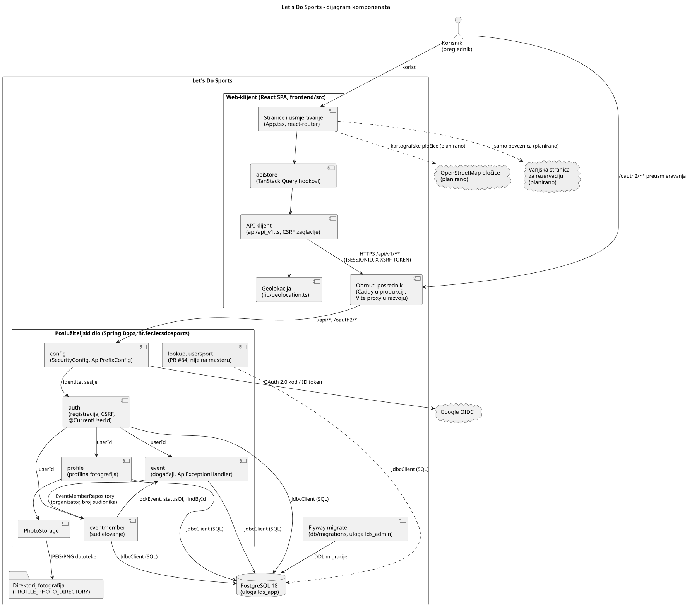
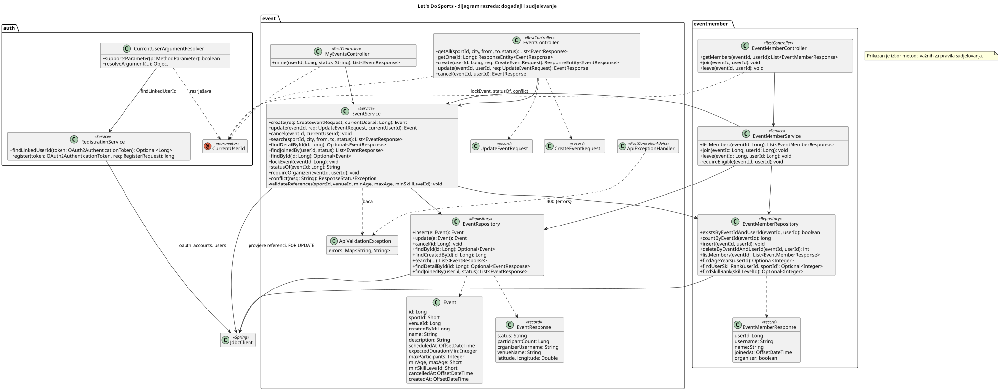
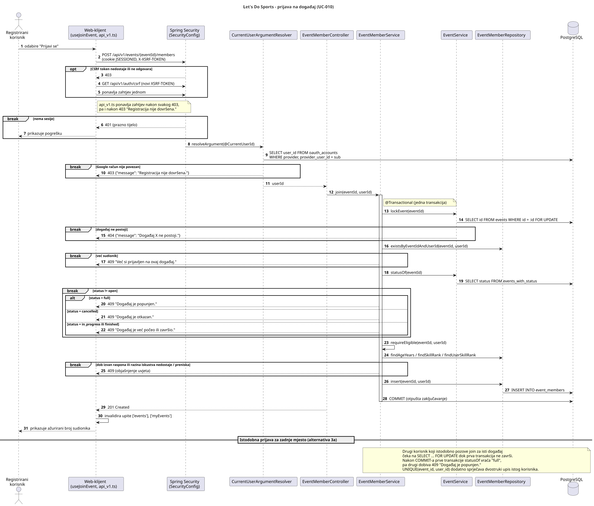
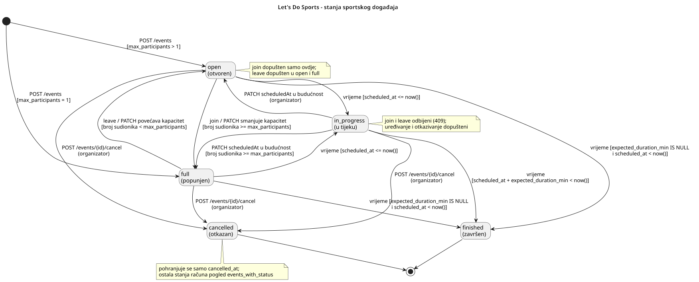

# 4. Arhitektura i oblikovanje

Let's Do Sports je monolitna web-aplikacija: web-klijent (React SPA) poziva jedan poslužiteljski dio (Spring Boot, REST API pod prefiksom `/api/v1`), a on podatke drži u bazi PostgreSQL. Poslužiteljski dio podijeljen je na module po funkcionalnostima (`auth`, `event`, `eventmember`, `profile`, ...), koji se postavljaju zajedno kao jedna aplikacija. Opis odgovara stanju grane `master` na dan 19. 11. 2026.; dijelovi iz otvorenih PR-ova označeni su brojem PR-a, a neizrađeni dijelovi oznakom „planirano”.

| Arhitekturni pogled | Ključno inženjersko pitanje | Primijenjeni model ili dijagram |
| :--- | :--- | :--- |
| **Strategija rješenja** | Koji stil i temeljne odluke određuju program? | Tablica odluka (odjeljak 4.1) |
| **Struktura podsustava** | Koji su glavni dijelovi i kako komuniciraju? | Dijagram komponenata (4.2) |
| **Model podataka** | Kako su strukturirani trajni podaci programa? | Relacijski ER dijagram (4.3.1) |
| **Struktura koda** | Kako su dodijeljene odgovornosti i ključni razredi? | Dijagram razreda za događaje i sudjelovanje (4.3.2) |
| **Dinamičko ponašanje** | Kako moduli surađuju pri obradi ključnih transakcija? | Sekvencijski dijagram prijave na događaj (4.4.1) |
| **Stanja sustava** | Kako ključni domenski objekt mijenja svoja stanja? | Dijagram stanja događaja (4.4.2) |
| **Fizički razmještaj** | Na kojim se izvršnim čvorovima program izvodi? | Dijagram razmještaja ([poglavlje 6](./6-Postavljanje-instalacija-i-konfiguracija.md), u izradi) |

---

Svi UML dijagrami izrađeni su u PlantUML-u. Izvori su u `docs/puml/`, a SVG slike u `docs/assets/diagrams/` generira GitHub workflow `generate-puml-diagrams.yaml` nakon spajanja izmjena u `master`.

## 4.1 Ključne arhitekturne odluke

| Odluka | Razmatrana alternativa | Projektno specifično obrazloženje i kompromis |
| --- | --- | --- |
| Jedan poslužiteljski dio (Spring Boot) s modulima po funkcionalnostima | Više zasebno postavljenih usluga | Tim od nekoliko ljudi u jednom semestru lakše razvija, postavlja i ispituje jednu aplikaciju. Moduli (`event`, `eventmember`, `auth`, `profile`) imaju odvojene odgovornosti, ali dijele proces i bazu. Kvar aplikacije zahvaća sve funkcionalnosti odjednom. |
| Prijava isključivo preko Googlea (OAuth 2.0 / OIDC), bez lozinki | Vlastita prijava e-poštom i lozinkom (početni zapis zahtjeva, 23. 10. 2026.) | Aplikacija ne pohranjuje lozinke, a identitet je Googleov `sub`. Svaki korisnik mora imati Google račun i nema povezivanja više računa (C-06). Obrazloženje je u ADR-01. |
| Poslužiteljska sesija (`JSESSIONID`) i CSRF zaštita | JWT koji čuva web-klijent | Token nije dostupan JavaScriptu, a odjava odmah poništava sesiju. Zahtijeva CSRF zaštitu i isto ishodište (engl. *same-origin*) za klijent i API. Obrazloženje je u ADR-02. |
| Stanje događaja računa se iz podataka (pogled `events_with_status`) | Stupac `status` koji održava poslužiteljski dio | Stanje se ne može razići s brojem sudionika i terminom. Cijena je izračun s `now()` i `COUNT` pri svakom upitu. Obrazloženje je u ADR-03. |
| Ručno pisani SQL preko Spring `JdbcClient`, shema u Flyway migracijama | JPA/Hibernate s automatskim stvaranjem sheme | Shemu i pravila (CHECK, UNIQUE, pogledi, okidači) drže SQL migracije u `db/migrations`. Migracije pokreće uloga `lds_admin` u zasebnom spremniku `migrate`, a aplikacija radi kao `lds_app` bez DDL prava. Mapiranje redaka u objekte piše se ručno, a aplikacija pri pokretanju ne provjerava je li shema ažurna. |
| Zaključavanje događaja (`SELECT ... FOR UPDATE`) pri prijavi i odjavi | Jedan uvjetni `INSERT ... SELECT ... WHERE count < max` | Sve provjere (status, dob, razina iskustva) izvode se nad zaključanim događajem, pa istodobne prijave ne mogu prepuniti događaj. Istodobne prijave na isti događaj čekaju jedna drugu. `UNIQUE(event_id, user_id)` je dodatna zaštita u bazi. |
| Isto ishodište za klijent i API (Vite proxy u razvoju, Caddy u produkciji) | CORS konfiguracija na poslužiteljskom dijelu | Kolačići sesije i CSRF-a rade bez CORS-a. Poslužiteljski dio u svakom okruženju mora biti iza posrednika. |

## 4.2 Gradivni blokovi i UML dijagram komponenata

**Slika 4.1. Dijagram komponenata sustava Let's Do Sports**

**PlantUML izvor:** [4-1-lets-do-sports-CMP.puml](./puml/4-1-lets-do-sports-CMP.puml)

| Komponenta | Odgovornost | Razlog za ovu granicu |
| --- | --- | --- |
| Web-klijent (`frontend/src`) | Stranice i usmjeravanje (`App.tsx`, react-router), dohvat i privremena pohrana podataka s poslužitelja (`apiStore/`, TanStack Query), HTTP klijent s CSRF zaglavljem (`api/api_v1.ts`), lokacija iz preglednika (`lib/geolocation.ts`). | Prikaz i interakcija odvojeni su od poslovnih pravila; svi pozivi API-ja prolaze kroz jedan modul. |
| Obrnuti posrednik (Caddy / Vite proxy) | Prosljeđuje `/api/*` i `/oauth2/*` poslužiteljskom dijelu, a ostale putanje poslužuje kao statičke datoteke klijenta. | Klijent i API dijele ishodište, pa kolačići rade bez CORS-a. U produkciji Caddy, poslužiteljski dio i PostgreSQL rade na jednom poslužitelju; detaljan razmještaj bit će u poglavlju 6. |
| `config` | `SecurityConfig` (OAuth 2.0 prijava, sesija, CSRF, javne i zaštićene rute) i `ApiPrefixConfig` (prefiks `/api/v1`, registracija `CurrentUserArgumentResolver`). | Sigurnosna pravila i konvencije API-ja definirani su na jednom mjestu za sve module. |
| `auth` | Registracija (`POST /auth/register`), CSRF token (`GET /auth/csrf`), anotacija `@CurrentUserId` i njezin resolver koji sesiju preslikava u `users.id`. | Kontroleri ostalih modula dobivaju samo `userId` i ne ovise o detaljima OAuth-a. |
| `event` | Stvaranje, pretraga, uređivanje i otkazivanje događaja, popis vlastitih događaja; globalni `ApiExceptionHandler`. | Pravila događaja (organizator, teren, uvjeti) imaju jedno mjesto. |
| `eventmember` | Popis sudionika, prijava i odjava s događaja. | Pravila sudjelovanja odvojena su od uređivanja događaja; modul koristi `EventService` za zaključavanje i stanje. |
| `profile` i `PhotoStorage` | Postavljanje i dohvat profilne fotografije; provjera, ponovno kodiranje i spremanje datoteke na disk. | Rad s datotečnim sustavom izoliran je iza jedne komponente, pa se pohrana može zamijeniti bez izmjene ostatka modula. |
| `lookup`, `usersport` (PR #84, nije na masteru) | Šifrarnici (`/sports`, `/cities`, `/skill-levels`) i zamjena popisa sportova korisnika. | Šifrarnici su javni i jednostavni. Zamjena cijelog popisa sportova namijenjena je uređivanju profila (`PATCH /users/me`, još nije izrađeno); registracija sportove upisuje zasebno. |
| PostgreSQL 18 i Flyway `migrate` | Trajna pohrana; shema iz `db/migrations` (V1–V6 na masteru, V7 u PR #84). | Shema i ograničenja definirani su neovisno o aplikaciji; migracije se izvode s drugom ulogom nego aplikacija. |
| Direktorij fotografija | Datoteke profilnih fotografija (`PROFILE_PHOTO_DIRECTORY`). | U bazi se pohranjuje samo URL. |

Izvan granice sustava su Google OIDC (prijava), OpenStreetMap pločice (planirano: karta još nije uvedena, a knjižnica za prikaz još nije odabrana) i vanjske stranice za rezervaciju terena (planirano: aplikacija će prema njima samo voditi poveznicom). Planirani moduli (komentari, tereni, prijave netočnosti, administracija, `GET/PATCH /users/me` i pretraga igrača) još nisu na masteru i nisu prikazani kao komponente. Pretraga igrača razvija se na grani `feature/users-api`.

## 4.3 Model podataka i oblikovanje razreda

### 4.3.1 ER dijagram i model podataka

**ER dijagram:**

**Slika 4.2. ER dijagram sustava Let's Do Sports (ERDv6)**

**Izvor dijagrama:** [Let's Do Sports - ERDv6.puml](./puml/Let's%20Do%20Sports%20-%20ERDv6.puml)

**Implementacija:** SQL migracije u [`db/migrations`](../db/migrations) (V1–V6 na masteru; V7 u PR #84) i opis baze u [`db/README.md`](../db/README.md).

Implementirane tablice prema migracijama:

- **V2:** šifrarnici `sif_city`, `sif_skill_level` (s `rank`) i `sports`; `users`, `venues`, `events`, `event_members` (`UNIQUE(event_id, user_id)`) i pogled `events_with_status`.
- **V3:** `user_sports`, `venue_sports` i dodatni podaci o terenu (plaćanje, rezervacija, vanjski URL).
- **V4–V6:** `sif_app_role`, `sif_permissions`, `app_role_has_permissions`, `oauth_accounts`; obavezni spol, datum rođenja i grad korisnika; jedan Google račun po korisniku.
- **V7 (PR #84):** odgođeni okidač `user_sports_last_sport_guard` koji pri `COMMIT`-u odbija brisanje ili premještanje zadnjeg sporta korisnika (unos korisnika bez sportova ne provjerava). Okidač nije prikazan u ERD-u.

Važne razlike između ERD-a i baze: ERDv6 prikazuje i tablice koje još nemaju migraciju, a nisu označene kao planirane: `messages` (komentari s `reply_to_id` i `deleted_at`), `venue_photos`, `venue_reports`, `sif_report_status`, `advertisements` i stupac `venues.cover_photo_id`. Stanje događaja nije stupac tablice `events`; pohranjuje se samo `cancelled_at`, a ostala stanja računa pogled `events_with_status` (4.4.2).

### 4.3.2 Reprezentativni UML dijagram razreda

Prikazan je modul događaja i sudjelovanja jer sadrži najviše poslovnih pravila (organizator, uvjeti prijave, kapacitet, zaključavanje) i povezuje se s identitetom korisnika iz modula `auth`.

**Dijagram razreda:**

**Slika 4.3. Dijagram razreda za događaje i sudjelovanje**

**PlantUML izvor:** [4-3-lets-do-sports-CD.puml](./puml/4-3-lets-do-sports-CD.puml)

**Referenca na kod pri završnom pregledu:** [`event`](../backend/LetsDoSports/src/main/java/hr/fer/letsdosports/event), [`eventmember`](../backend/LetsDoSports/src/main/java/hr/fer/letsdosports/eventmember), [`auth/CurrentUserArgumentResolver.java`](../backend/LetsDoSports/src/main/java/hr/fer/letsdosports/auth/CurrentUserArgumentResolver.java)

Kontroleri primaju HTTP zahtjev, provjeravaju tijelo (`@Valid`) i dobivaju `userId` preko `@CurrentUserId`; frontend nikad ne šalje `userId`. Servisi (`EventService`, `EventMemberService`) provode pravila u transakciji, a repozitoriji izvode SQL preko `JdbcClient` i rezultat mapiraju u `Event` ili u zapise (`record`) poput `EventResponse` i `EventMemberResponse`. `EventMemberService` koristi `EventService.lockEvent`, `statusOf`, `findById` i `conflict`, a `EventService` koristi `EventMemberRepository` za upis organizatora i provjeru broja sudionika, pa moduli `event` i `eventmember` ovise jedan o drugome (4.7). Odstupanje od slojeva: `EventService` i `RegistrationService` dio upita (provjere referenci, zaključavanje) izvode izravno preko `JdbcClient`, bez repozitorija.

## 4.4 Ponašanje tijekom izvođenja

### 4.4.1 Reprezentativni UML sekvencijski dijagram

**Scenarij:** Prijava registriranog korisnika na događaj (UC-010), `POST /api/v1/events/{eventId}/members`, uz neuspješne putove i istodobnu prijavu za zadnje mjesto.

**Sekvencijski dijagram:**

**Slika 4.4. Sekvencijski dijagram prijave na događaj (UC-010)**

**PlantUML izvor:** [4-4-lets-do-sports-SD.puml](./puml/4-4-lets-do-sports-SD.puml)

Zahtjev prvo prolazi Spring Security. CSRF provjera dolazi prije provjere prijave: bez valjanog tokena odgovor je 403, a `api_v1.ts` tada dohvaća novi token preko `GET /api/v1/auth/csrf` i ponavlja zahtjev jednom (to radi nakon svakog 403). Bez sesije odgovor je 401 bez tijela, a klijent prikazuje pogrešku. Resolver zatim vraća 403 „Registracija nije dovršena.” ako Google račun nije povezan s korisnikom. `EventMemberService.join` u jednoj transakciji zaključava događaj (404 ako ne postoji) i redom provjerava je li korisnik već prijavljen, stanje događaja (`full`, `cancelled`, `in_progress`/`finished`) te dob i razinu iskustva (409 s objašnjenjem). Tek tada upisuje `event_members` i vraća 201. Druga istodobna prijava čeka na zaključavanje i nakon `COMMIT`-a prve vidi novi broj sudionika.

### 4.4.2 Reprezentativni UML dijagram stanja

**Vlasnik stanja i razlog odabira:** Sportski događaj. Njegovo stanje određuje koje su radnje dopuštene (prijava, odjava, uređivanje, otkazivanje). Stanje se ne pohranjuje: pogled `events_with_status` (V2) računa ga ovim redoslijedom: `cancelled` (postoji `cancelled_at`), `finished` (`scheduled_at + expected_duration_min < now()`), `in_progress` (`scheduled_at <= now()`), `full` (broj sudionika `>= max_participants`), inače `open`. Organizator se upisuje kao sudionik i ulazi u kapacitet.

**Dijagram stanja:**

**Slika 4.5. Dijagram stanja sportskog događaja**

**PlantUML izvor:** [4-5-lets-do-sports-SM.puml](./puml/4-5-lets-do-sports-SM.puml)

Prijava je moguća samo u stanju `open`, a odjava u stanjima `open` i `full`; organizator se ne može odjaviti nego otkazuje događaj. Uređivanje i otkazivanje dopušteni su i dok je događaj `in_progress`, a za `cancelled` i `finished` vraćaju 409. Smanjenje kapaciteta ispod trenutačnog broja sudionika odbija se s 400. Ako trajanje nije zadano, događaj iz `open`/`full` prelazi izravno u `finished` čim prođe `scheduled_at`. Organizator može događaj u stanju `in_progress` urediti i pomaknuti termin u budućnost, pa se on vraća u `open` ili `full`.

## 4.5 Zapisi arhitekturnih odluka

| ID | Datum | Odluka | Razmatrana alternativa | Obrazloženje i kompromis | Status |
| --- | --- | --- | --- | --- | --- |
| ADR-01 | 23. 10. 2026., dopuna 11. 11. 2026. | Prijava samo preko Googlea (OIDC) | Vlastita prijava e-poštom i lozinkom | Nema pohrane lozinki; ovisnost o Googleu i jedan račun po korisniku. | Prihvaćeno |
| ADR-02 | 14.–18. 11. 2026. | Poslužiteljska sesija, CSRF i identitet iz `oauth_accounts` | JWT u web-klijentu; `userId` iz zahtjeva klijenta | Token nije dostupan JavaScriptu i odjava je trenutna; aplikacija čuva stanje sesije. | Prihvaćeno (implementirano); ugovor u PR #75 |
| ADR-03 | 29. 10. 2026. | Stanje događaja računa pogled `events_with_status` | Pohranjeni stupac `status` | Stanje se ne može razići s podacima; izračun pri svakom upitu. | Prihvaćeno |

### ADR-01: Prijava samo preko Googlea (OIDC)

| Polje | Zapis odluke |
| --- | --- |
| Kontekst i cilj | Korisnici se moraju prijaviti prije stvaranja događaja i prijave na njih. Tim ne želi održavati pohranu lozinki, oporavak lozinke ni potvrdu e-pošte. |
| Kriteriji odluke | Sigurnost bez vlastitog upravljanja lozinkama, podrška u Spring Securityju (`oauth2Login`), jednostavan tijek za korisnika. |
| Razmatrane alternative | **Vlastita prijava e-poštom i lozinkom** (početni zapis zahtjeva 23. 10. 2026.): potpuna kontrola, ali hashiranje, oporavak i potvrda e-pošte. **Google OIDC:** gotov pružatelj identiteta. |
| Odluka i obrazloženje | Prijava samo preko Googlea (C-06). Identitet je Googleov `sub` u `oauth_accounts`; e-pošta je samo informativna i ne spaja račune. Prijava sama ne stvara korisnika: lokalni račun nastaje tek nakon registracije (`POST /api/v1/auth/register`). Odričemo se korisnika bez Google računa i povezivanja više računa. Ograničenja u bazi uvodi V6 (`provider IN ('google')`, `UNIQUE(user_id, provider)`). |
| Status | Prihvaćeno; implementirano (`SecurityConfig`, `RegistrationService`, V4–V6). |

### ADR-02: Poslužiteljska sesija i CSRF umjesto tokena u web-klijentu

| Polje | Zapis odluke |
| --- | --- |
| Kontekst i cilj | Nakon Google prijave web-klijent mora slati autentificirane zahtjeve API-ju, a poslužiteljski dio mora pouzdano znati koji je lokalni korisnik u pitanju. |
| Kriteriji odluke | Token ne smije biti dostupan JavaScriptu (`localStorage`), odjava mora odmah vrijediti, rješenje mora biti izvorno podržano u Spring Securityju, a klijent ne smije sam birati `userId`. |
| Razmatrane alternative | **JWT u web-klijentu:** poslužitelj ne čuva stanje, ali token je izložen skriptama i teško ga je opozvati. **`userId` ili zaglavlje `X-User-Id` iz klijenta:** korišteno samo privremeno u razvoju i napušteno. **Sesija s kolačićem `JSESSIONID` (HttpOnly):** zahtijeva CSRF zaštitu. |
| Odluka i obrazloženje | Sesija (`JSESSIONID`) i CSRF u SPA obliku (`csrf.spa()`: kolačić `XSRF-TOKEN`, zaglavlje `X-XSRF-TOKEN`). `CurrentUserArgumentResolver` pri svakom zahtjevu traži korisnika u `oauth_accounts` po (`provider`, `sub`), pa se sesija nakon registracije ne mijenja. Neprijavljeni dobivaju 401 bez preusmjeravanja, a prijavljeni bez registracije 403. Kompromis: aplikacija čuva stanje sesije (jedna instanca) i zahtijeva isto ishodište za klijent i API. |
| Status | Prihvaćeno; implementirano. Ugovor autentifikacije opisan je u PR #75 (`docs/meeting-notes/autentifikacija-i-profil.md`, nije na masteru). |

### ADR-03: Izvedeno stanje događaja

| Polje | Zapis odluke |
| --- | --- |
| Kontekst i cilj | Događaj može biti otvoren, popunjen, u tijeku, završen ili otkazan. Stanje ovisi o broju sudionika i protoku vremena, a mora biti točno pri prijavi, odjavi i filtriranju. |
| Kriteriji odluke | Stanje se ne smije razići sa stvarnim podacima; ne želimo zakazane poslove koji mijenjaju stanje. |
| Razmatrane alternative | **Stupac `status` koji održava poslužiteljski dio:** jednostavno čitanje, ali svaka prijava, odjava, izmjena kapaciteta i protok vremena moraju ga ažurirati. **Izračun u pogledu baze.** |
| Odluka i obrazloženje | Pohranjuje se samo `cancelled_at`, a pogled `events_with_status` računa stanje iz `scheduled_at`, `expected_duration_min`, `max_participants` i broja redaka u `event_members`. Odluka je donesena na sastanku 29. 10. 2026. (`docs/meeting-notes/baza-dogadaji-2026-10-29.md`). Kompromis: izračun s `now()` i `COUNT` pri svakom upitu i bez indeksa za filtriranje po stanju, što je prihvatljivo za opseg projekta. |
| Status | Prihvaćeno; implementirano (V2, `EventService.statusOf`, `EventRepository`). |

## 4.6 Zajednička pravila oblikovanja (engl. Cross-cutting concerns)

| Aspekt | Mehanizam | Pravilo | Mjesto primjene |
| --- | --- | --- | --- |
| Autentifikacija | Spring Security `oauth2Login` i sesija | Javni su OAuth putanje, `/error` i `GET` za `/api/v1/events`, `/events/{eventId}`, `/events/{eventId}/comments`, `/sports`, `/sports/{sportId}`, `/venues`, `/venues/{venueId}` i `/auth/csrf` (PR #84 dodaje `/cities` i `/skill-levels`). Ostatak `/api/**` traži prijavu, a sve ostalo je zabranjeno (`denyAll`). Neprijavljeni dobivaju 401 bez tijela. Odjava (`POST /api/v1/auth/logout`) poništava sesiju i briše kolačiće. | `config/SecurityConfig.java` |
| Identitet korisnika | `@CurrentUserId` i `CurrentUserArgumentResolver` | `userId` se uvijek određuje iz sesije preko `oauth_accounts`; nepovezan račun dobiva 403 „Registracija nije dovršena.”. | `auth/CurrentUserArgumentResolver.java`, `config/ApiPrefixConfig.java` |
| Autorizacija nad zapisom | Provjera u servisu | Samo organizator uređuje i otkazuje događaj (403); organizator se ne može odjaviti (409). Uloga `ADMIN` postoji u bazi, ali se još nigdje ne provjerava. | `EventService.requireOrganizer`, `EventMemberService.leave` |
| CSRF | `csrf.spa()` | Svaka izmjena šalje `X-XSRF-TOKEN` iz kolačića `XSRF-TOKEN`; klijent pri 403 dohvaća novi token i ponavlja zahtjev jednom. | `SecurityConfig`, `auth/CsrfController.java`, `frontend/src/api/api_v1.ts` |
| Validacija i format pogrešaka | Bean Validation na zapisima zahtjeva, provjere referenci u servisu, globalni `@RestControllerAdvice` | Pogreške unosa vraćaju 400 `{"errors": {"polje": "poruka"}}`, a ostale pogreške status i `{"message": "..."}` (404, 409, 403). | `event/ApiExceptionHandler.java`, `event/ApiValidationException.java`, `profile/ProfilePhotoExceptionHandler.java` |
| Transakcije i konkurentnost | `@Transactional` i `SELECT ... FOR UPDATE` | Prijava, odjava, uređivanje i otkazivanje zaključavaju redak događaja. Registracija upisuje `users`, `user_sports` i `oauth_accounts` u jednoj transakciji. Zamjena fotografije zaključava redak korisnika. | `EventService.lockEvent`, `EventMemberService`, `RegistrationService.register`, `ProfilePhotoService` |
| Ograničenja u bazi | CHECK, UNIQUE, FK, okidač | Baza je zadnja zaštita: `UNIQUE(event_id, user_id)`, `max_participants >= 1`, `min_age <= max_age`, dopušteni spol i datum rođenja, jedan Google račun po korisniku; V7 (PR #84) odbija brisanje zadnjeg sporta korisnika. | `db/migrations/V2`–`V6`, V7 u PR #84 |
| Pristup bazi | Najmanje ovlasti | Migracije pokreće `lds_admin` (Flyway), a aplikacija se spaja kao `lds_app` sa samo `SELECT/INSERT/UPDATE/DELETE`. | `db/compose.yml`, `db/init-db/01-create-appuser-role.sh`, `V1__app_user_grants.sql` |
| Pohrana datoteka | `PhotoStorage` | Prihvaća samo JPEG i PNG do 5 MiB i 4096 × 4096 px; slika se ponovno kodira (uklanja metapodatke) i sprema pod UUID imenom. Stara datoteka briše se tek nakon `COMMIT`-a. Pogreška pohrane vraća 503. | `profile/PhotoStorage.java`, `profile/ProfilePhotoService.java` |
| Konvencije API-ja | Prefiks `/api/v1` | Prefiks se automatski dodaje svim `@RestController` razredima. | `config/ApiPrefixConfig.java` |
| Konfiguracija i tajne | Varijable okruženja i `.env` | Google `client-id`/`secret`, `BACKEND_URL` i `FRONTEND_URL` čitaju se iz `.env` (nije u repozitoriju; postoji `.env.example`). Podaci za spajanje na bazu dolaze iz `db/.env` preko `Makefile`-a. | `application.properties`, `backend/LetsDoSports/Makefile` |
| Upravljanje ovisnostima | Injektiranje ovisnosti kroz konstruktor | Servisi i repozitoriji primaju ovisnosti (`JdbcClient`, repozitorije, druge servise) preko konstruktora Spring beanova. | Svi `@Service` i `@Repository` razredi |

## 4.7 Arhitekturni rizici i tehnički dug

**Tehnički rizici i dug**

| Rizik ili kompromis | Posljedica | Odgovor na rizik |
| --- | --- | --- |
| Nema obrade `DataIntegrityViolationException` | Kršenje ograničenja u bazi (utrka na korisničkom imenu, CHECK za spol ili datum rođenja, okidač V7) vraća 500 umjesto 400/409. | Dodati preslikavanje u `ApiExceptionHandler` (prijedlog u PR #75). |
| Neusklađen naziv polja `dateOfBirth` / `birthDate` | `RegistrationIntegrationTest`, `docs/meeting-notes/api-endpoints.md` i tablica 2.5 u [poglavlju 2](./2-Analiza-zahtjeva.md) koriste `birthDate`, a `RegisterRequest` i web-klijent `dateOfBirth`. Nepoznata polja se prešutno ignoriraju, pa uspješni slučaj testa vraća 400. | Na reviewu PR-a #75 dogovoren je `dateOfBirth`. Uskladiti test, `UpdateUserRequest` na grani `feature/users-api`, `api-endpoints.md` (PR #75) i dodati redak u tablicu 2.5. |
| Nema automatskog pokretanja testova prije postavljanja | Pad testova ne blokira spajanje ni postavljanje; postavljanje se pokreće pri svakom pushu na `master` i preskače `tsc -b`. | Dodati GitHub Actions workflow za testove poslužiteljskog dijela i provjeru tipova. |
| Profilne fotografije na lokalnom disku jednog poslužitelja | Nema kopije ni rada s više instanci. U repozitoriju nije vidljivo da je `PROFILE_PHOTO_DIRECTORY` postavljen u produkciji; zadana putanja (`${user.home}/.lets-do-sports`) nije među zapisivim putanjama servisa s `ProtectSystem=strict`, pa upis vjerojatno vraća 503. | Prihvaćeno za opseg projekta. Provjeriti na poslužitelju i postaviti zapisivi direktorij. Pohrana je iza `PhotoStorage` pa se može zamijeniti. |
| Jedan poslužitelj za klijent, API i bazu | Kvar ili ponovno pokretanje prekida rad cijele aplikacije; nema prebacivanja na pričuvni sustav (failover). | Prihvaćeno u okviru ograničenja kolegija (poglavlje 6). |
| Ostaci razvojnog identiteta `X-User-Id` | `docs/profile-photo.md`, `ProfilePhoto.tsx` i `ProfilePhotoPersistenceIT` još ga spominju iako ga resolver više ne čita. | Ukloniti ostatke i ažurirati opis. |
| Djelomično lažni podaci u web-klijentu | Korisnici dolaze iz testnih podataka (`USE_DUMMY_USERS`), a sportovi i gradovi su uvijek ugrađeni testni podaci (`getSports`, `getCities`), pa klijent nije potpuno usklađen s API-jem. | Prebaciti na stvarne krajnje točke nakon spajanja PR #84 i `feature/users-api`. |
| Javne rute bez kontrolera | `SecurityConfig` unaprijed dopušta `/sports`, `/sports/{sportId}`, `/venues`, `/venues/{venueId}` i `/events/{eventId}/comments`, koje na masteru nemaju kontroler (`/sports` dolazi u PR-u #84). | Uskladiti popis javnih ruta s implementiranim kontrolerima. |
| Zastarjela dokumentacija i ERD | `validacija_i_specifikacija.md` i `api-endpoints.md` (putanja OAuth povratnog poziva, otkazivanje kao `status`) proturječe kodu; ERDv6 miješa implementirane i planirane tablice. | Ažurirati dokumente i označiti planirane tablice u sljedećoj inačici ERD-a. |
| Međuovisnost modula `event` i `eventmember` | Promjena u jednom modulu lako zahvaća drugi; modul se ne može izdvojiti ni ispitati zasebno. | Prihvaćeno za sada; pri sljedećem preuređenju izdvojiti zajednički servis za kapacitet i članstvo. |
| Web-klijent ponavlja svaki 403 | Nakon 403 „Registracija nije dovršena.” klijent nepotrebno dohvaća CSRF token i šalje zahtjev još jednom. | Ponavljati samo kad 403 nema tijela s porukom (CSRF). |
| `ApiExceptionHandler` u paketu `event` | Globalno pravilo nalazi se u modulu jedne funkcionalnosti, pa ga je teško pronaći. | Premjestiti u zajednički paket. |
| Brisanje korisnika i terena | `events.created_by_id` i `events.venue_id` nemaju `ON DELETE`, pa se ne može obrisati korisnik koji je organizirao događaj ni teren s događajima. | Odlučiti pri implementaciji administracije (F-021). |

**Poslovni ili domenski rizici**

| Rizik | Posljedica | Odgovor na rizik |
| --- | --- | --- |
| Netočni podaci o terenima koje unose korisnici (AS-03) | Korisnici dolaze na zatvoren ili pogrešno opisan teren. | Planirane su prijave netočnosti i administratorska obrada (F-020, F-021). |
| Osobni podaci korisnika | Datum rođenja i spol mogu otkriti više nego što je potrebno za sudjelovanje. | API drugim korisnicima ne vraća datum rođenja, spol ni e-poštu (F-005). |
| Google OAuth u načinu rada *Testing* | Prijaviti se mogu samo dodani testni korisnici. | Prije javnog predstavljanja objaviti aplikaciju u Google Cloud Consoleu ili dodati testne korisnike. |
